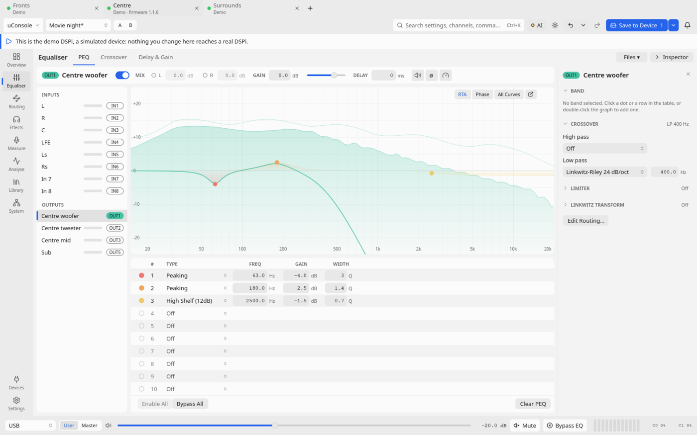
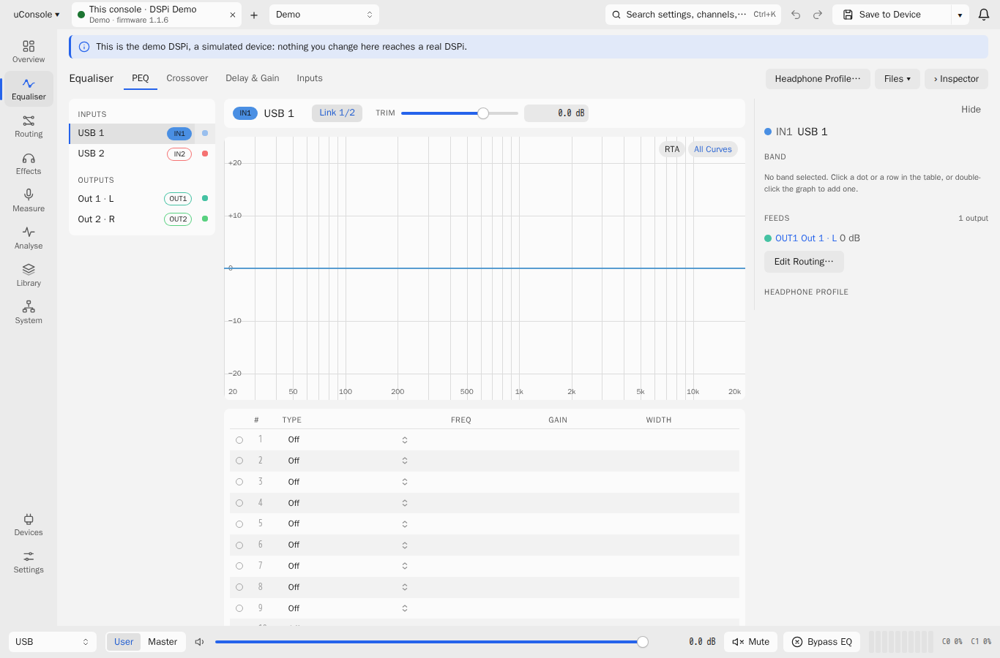
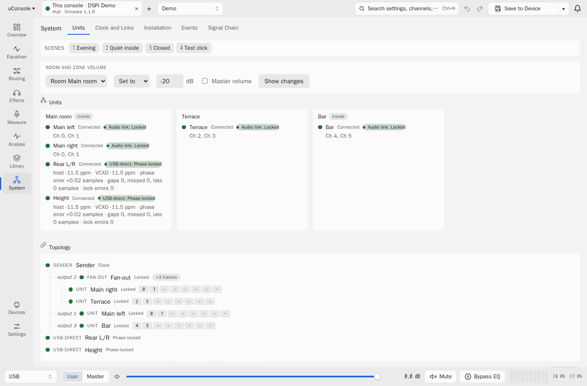
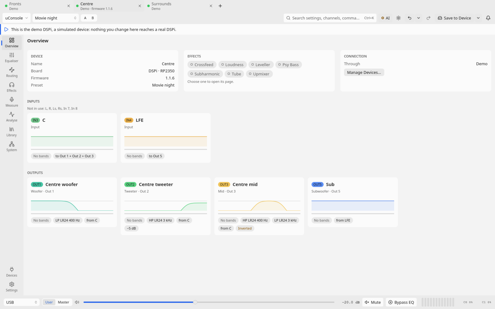
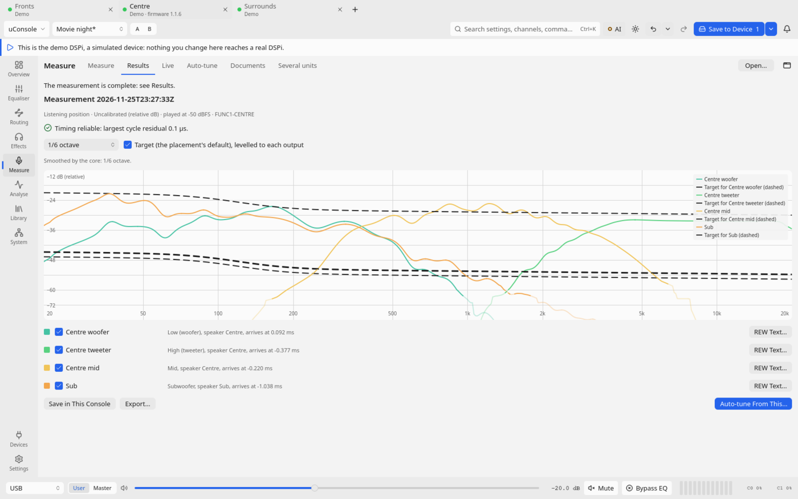
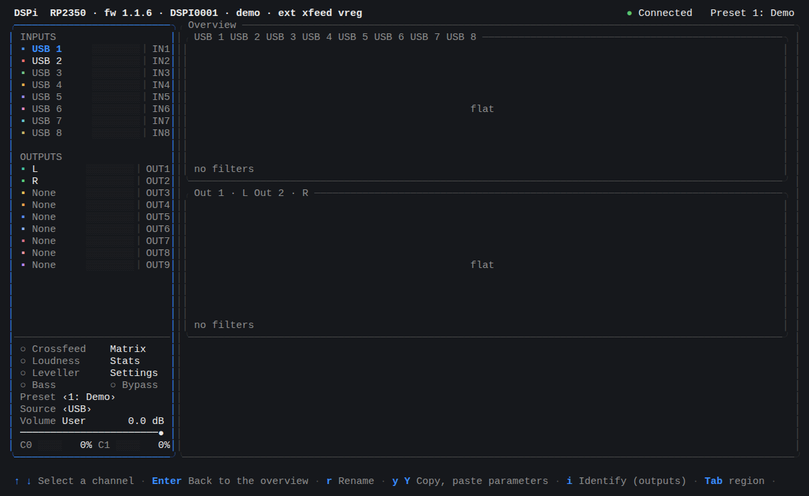

# uConsole for DSPi

**One console for [DSPi](https://github.com/WeebLabs/DSPi) audio processors, on the desktop, on Android, in the
browser and in the terminal, from one Rust core.**

Plug in one DSPi and it is a plain, friendly console: volume, presets, EQ with a live response graph, crossovers,
routing and effects, with a demo device so you can try everything without hardware. Where it stands out is the
professional side: **several units playing as one system** over the audio link (alink) on a shared time base,
**auto-tune with a measurement microphone**, a **hub** that serves every unit to every console on the network with
roles, and **installer modes** that hand a finished system over to its owner, locked to safe limits. And an **AI agent**
on your computer (Claude, Cursor and other MCP clients) can work with you, under rules that protect your speakers.

## Highlights

- **Two layouts on the desktop.** **Modern** (new installs start here): a rail of sections, every tool on a page, the
  open devices as tabs side by side, a command palette (Ctrl+K). **Classic**: the menu bar and tool windows of earlier
  versions. Settings › Appearance switches at any time; the web console has the same Modern pages.
- **AI agents, safely.** Turn them on in Settings › AI Agents and an agent such as Claude Desktop, Claude Code or
  Cursor can read and change your DSPi, measure and tune it. Risky changes wait for your answer, every change can be
  undone, and a tweeter's protection holds whatever the agent is told ([manual](docs/manual/ai-agents.md)).
- **Your speaker setup.** Settings › Speakers says which output drives what (woofer, midrange, tweeter, sub); the
  console can detect it with quiet test sweeps, and measurement and agents follow it.
- **Multi-unit systems over the alink** †. A sender, fan-outs and receivers, USB-direct units and S/PDIF followers on
  one time base: a System view with every unit's lock state and delay, rooms and zones, scenes recalled at an exact
  frame, and the alignment of the units' delays.
- **Measurement and auto-tune.** A calibrated microphone (UMIK-1/2, REW, CSV, Dayton Audio files) and the DSPi's own
  test generator: response, RTA and auto-tune of delay, polarity, crossover and EQ. It is guarded throughout: the level
  ramps up from quiet, a mandatory summed check comes before any apply, the apply sits between "Before" and "After"
  snapshots, a verify follows, and you Keep or it reverts by itself. Several units can be measured with one
  microphone through the hub †.
- **The hub and DSPi Link.** `uconsole hub` (or the Qt app's sharing) serves your DSPi units over DSPi Link with TLS,
  pinned keys, PIN pairing and roles (Viewer, Control, Admin); `uconsole hub --web` also serves the web console to any
  browser on the local network. Inventory, health, alarms, schedules, MQTT and Home Assistant, a REST API, groups and a
  guarded firmware rollout. Its installation (rooms, zones, units, sources and scenes) is set up from the desktop app
  or the web console.
- **Simple, Advanced and Installer modes.** A front page for listening; the full tools for tuning; and an Installer
  mode with limits profiles (gain, high-pass, delay, limiter ceiling, EQ boost, volume) and an installer PIN that
  leaves the user volume, mute and presets.
- **Safe changes.** Snapshots and A/B compare, safe apply with a way back, document diffs and partial imports, undo
  and redo, and confirmation for every dangerous write. A revert that cannot put everything back says so.
- **Firmware updates that check first.** The update check reads the board before anything is written and refuses an
  image built for the wrong kind of device (the fork's images carry kind and core-voltage stamps †); leaving the
  fork's firmware asks you to confirm. Both firmware generations, 1.1.6 and upstream's paged 1.1.7 beta as of 2026-11-18 (later 1.1.7 betas may need an update), are supported.

† **Needs the DSPi fork firmware** on the device: [Bofr5555/DSPi](https://github.com/Bofr5555/DSPi), release
[v1.1.6-bofr1](https://github.com/Bofr5555/DSPi/releases/tag/v1.1.6-bofr1) ([which image](docs/INSTALL.md#fork-firmware)). Everything else works on stock Weeb Labs firmware, 1.1.6 or upstream's paged 1.1.7 beta as of 2026-11-18 (later 1.1.7 betas may need an update)
([what needs which firmware](docs/FEATURES.md#firmware-stock-vs-fork)).

## Screenshots

| | |
|---|---|
|  |  |
| **Equaliser** (web console): the same pages as the desktop's Modern layout | **System view** (web console on a hub): rooms, zones and alink lock states |
|  |  |
| **Overview** (desktop, Modern): one card per channel, its speaker's name and role, its response | **Measure › Results** (desktop, Modern): a measured response of each driver against its target |

*The `uconsole` Terminal. All pictures are real renders on demo devices: the desktop app's on the function test's
simulated home theatre (three DSPi units, a simulated microphone), the web console's on the demo DSPi and the demo hub
([`tools/shots/readme.sh`](tools/shots/readme.sh) makes them again).*

## Features

- **Every DSPi control:** volume and modes, inputs, PEQ on the graph, crossovers (with Linkwitz), delays, gains,
  matrix mixer, loudness, crossfeed, leveller, bass, subharmonic, tube, upmixer, limiters, presets, filter files and
  AutoEQ with a preview, control surfaces, signal generator, analyser and statistics.
- **For installations:** limits profiles, the installer lock, power-on state, the event log and diagnostics bundles;
  the alink System view, alignment and scenes †; core voltage †.
- **On the network:** the DSPi Link hub with roles and TLS; shared snapshots, history and alarms in every client,
  Identify †; fleet screens, bulk apply and the firmware rollout in the web console.
- **Measurement:** single-unit measurement, live response and RTA, auto-tune, measurement documents and REW export;
  multi-unit measurement †.
- **AI agents** (desktop app; `uconsole mcp` relays to it): reading and editing, presets and snapshots, measuring and
  auto-tune, speaker detection and roles from your words, installation setup, with questions, undo and hard limits.
- **Several devices at once** (Modern layout, web console), the redrawn matrix mixer, presets in one popover, and
  outputs nothing plays to left out of the views that only show.

Which feature works in which client, and on which firmware, is in [**Features**](docs/FEATURES.md).

## Get it

Release **0.15.0**, one version for every client ([install guide](docs/INSTALL.md),
[Releases page](https://github.com/Bofr5555/dspi-unified-console/releases)):

- **Windows** 10/11: installer or portable zip ([how](docs/INSTALL.md#windows))
- **Linux:** `.deb`, `.rpm`, AppImage, tar.gz or AUR, plus a one-time USB rule ([how](docs/INSTALL.md#linux))
- **macOS** 12+: the Qt app as a universal `.dmg` for Intel and Apple silicon, not notarised: open it once by hand ([how](docs/INSTALL.md#macos))
- **Android** 8+: Google Play (*uConsole for DSPi*, being rolled out to production) or the APK ([how](docs/INSTALL.md#android))
- **Terminal** `uconsole` for Linux, Windows and macOS: interface, scripting and the hub ([how](docs/INSTALL.md#terminal-uconsole))
- **Web console:** served by `uconsole web` or a hub, Chrome or Edge for USB ([how](docs/INSTALL.md#web-console))
- **iPhone and iPad:** the Swift apps exist but are not part of this release ([why](docs/INSTALL.md#iphone-and-ipad))

Every file is listed in a `SHA256SUMS` signed with minisign ([check a download](docs/INSTALL.md#check-a-download)).

## More

| | |
|---|---|
| [Install](docs/INSTALL.md) | Each system step by step, the Linux USB rule, checking a download |
| [Features](docs/FEATURES.md) | What works where (Qt, Android, web, Terminal, the Apple apps), and on which firmware |
| [Manual](docs/manual/) | [Measurement and auto-tune](docs/manual/measurement.md), [AI agents](docs/manual/ai-agents.md) (and [from another computer](docs/mcp-ssh-forwarding.md)), [firmware versions, hubs and updates](docs/manual/notices.md) |
| [Integrator guide](docs/integrator/README.md) | The hub and its API, security, documents, the alink, measurement, protocols |
| [Status](docs/STATUS.md) | Each client's state, what each phase built, what is still owed |
| [Building](docs/BUILDING.md) | Layout, building and testing in containers, the core |
| [Credits](docs/CREDITS.md) | The work this is built on: Weeb Labs' DSPi firmware, consoles, Terminal and DSPi Link |
| [Licences](docs/LICENCES.md) | GPL version 3; [`LICENSE`](LICENSE), [`NOTICE.md`](NOTICE.md) |
| [Changelog](CHANGELOG.md) · [Glossary](docs/GLOSSARY.md) | What changed; the words used |

uConsole for DSPi is not an official Weeb Labs project. It builds on Weeb Labs' DSPi firmware, DSPi Consoles,
DSPi-Terminal and DSPi-Link, and talks to stock DSPi firmware as well as to the extensions of the
[DSPi fork firmware](https://github.com/Bofr5555/DSPi). "DSPi" and "DSPi Console" are Weeb Labs' names.
